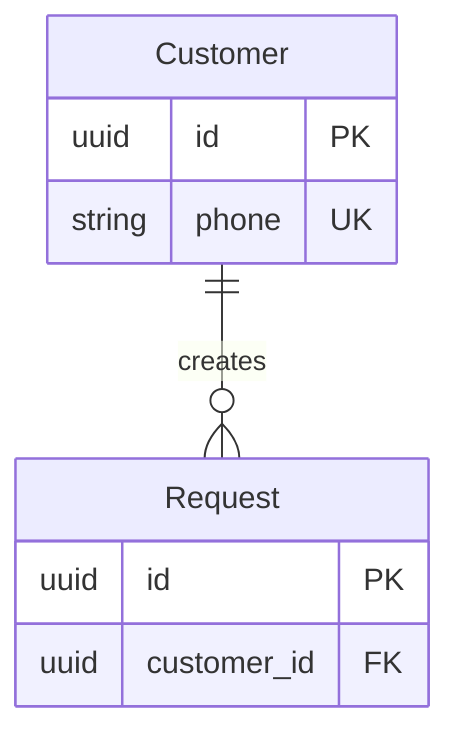

# Pack templates

All four files go next to PRD.md, in the PRD language, with English headings and
IDs. Every claim cites a PRD ID (`US-01`, `NG-02`, `NFR-SEC-1`, `D-03`).

## data-model.md

~~~markdown
# Data model: <product>
Source: PRD.md v<n>

## Entities
### E-Customer
| Field | Type | Required | Notes |
|---|---|---|---|
| id | uuid | yes | internal key |
| phone | string | yes | unique; identifies the customer (D-02) |

### E-Request
| Field | Type | Required | Notes |
|---|---|---|---|
| id | uuid | yes | internal key |
| customer_id | uuid | yes | owner (NFR-SEC-1) |

## Links
| From | To | Cardinality | Why |
|---|---|---|---|
| E-Customer | E-Request | 1 → many | US-01 |

## Diagram


## Rules
- Who may read/write each entity (links to NFR-SEC-*).
- Retention and deletion (links to NFR-PRIV-*).
~~~

Diagram rules:
- Diagram name = entity ID without `E-` (`E-Customer` → `Customer`).
- Every entity and every Links row appears on the diagram, and nothing else.
- Each entity block lists its key fields: `PK`, every `FK`, every `UK`, and
  fields used by the Rules section or by an AC. The Entities tables hold the
  full field list.
- `PK` is an internal id, never personal data (phone, email, plate): a
  personal `PK` copies into every `FK` and blocks deletion (NFR-PRIV-*).
  Mark the personal identifier `UK` instead.
- Every personal field that NFR-PRIV-* names is a field of some entity. If
  the PRD names one that no entity has, ask.
- Cardinality: `1 → 1` = `||--||`, `1 → 0..1` = `||--o|`,
  `1 → many` = `||--o{`, `1 → 1..many` = `||--|{`. Many-to-many becomes a
  link entity with two `1 → many` links.
- More than 12 entities: one diagram per group of related entities (one
  subsection each), with a shared entity repeated on each diagram that links
  to it. architecture.md later reuses these groups as modules.

## architecture.md

```markdown
# Architecture: <product>
Source: PRD.md v<n> · Style: one app with modules (monolith)

## Modules
| Module | Owns | Stories |
|---|---|---|

## Layers
| Layer | Job in this product |
|---|---|
| Browser | … |
| Frontend | draws screens, sends requests; holds no secrets, no business rules |
| API | checks the login token, rejects bad input (422) |
| Service | business rules, e.g. "a customer sees only her own requests" |
| Data access | the only code that knows where data is stored |
| Database | stores facts; row-level security as a safety net |
| External | <AI provider, messaging…>: called only from the service layer |

## One request, traced
<main user action>: step by step down the layers and back up, 6–10 lines.

## API contract
### <METHOD> /api/<resource>
- Who may call: …
- Inputs: …
- Returns: …
- Errors: 401 not signed in · 403 not yours · 422 bad input

## Background jobs
| Job | Why not inline | Retry rule |
|---|---|---|

## Not in this architecture
Components deliberately left out, each with the PRD line that rules it out.
```

## adr/001-<slug>.md

```markdown
# ADR-001: <decision as a short sentence>
Status: accepted · Date: <YYYY-MM-DD> · Source: PRD.md D-nn

| Field | Answer |
|---|---|
| Decision | What did we choose? |
| Alternative | What did we seriously consider and reject? |
| Reason | Why this one, given what we knew then? |
| Cost | What do we give up, knowingly? |
| Revisit when | Which concrete fact or number would make us decide again? |
```

## critique.md

```markdown
# Critique: rejected architecture proposal
Source of proposal: <pasted by user | illustrative, written by the assistant>

## The proposal
<numbered list of components>

## Verdict
| # | Proposed | Why we reject it | Ruled out by | Instead |
|---|---|---|---|---|
| 1 | Five microservices | ~30 requests a month; network calls can fail, nothing gained | architecture.md "monolith first", M-1 scale | one app, four modules |

## Message to send back to the AI
"Here are our PRD.md and ADR-001. Propose again, and justify every component
against the non-goals."
```
